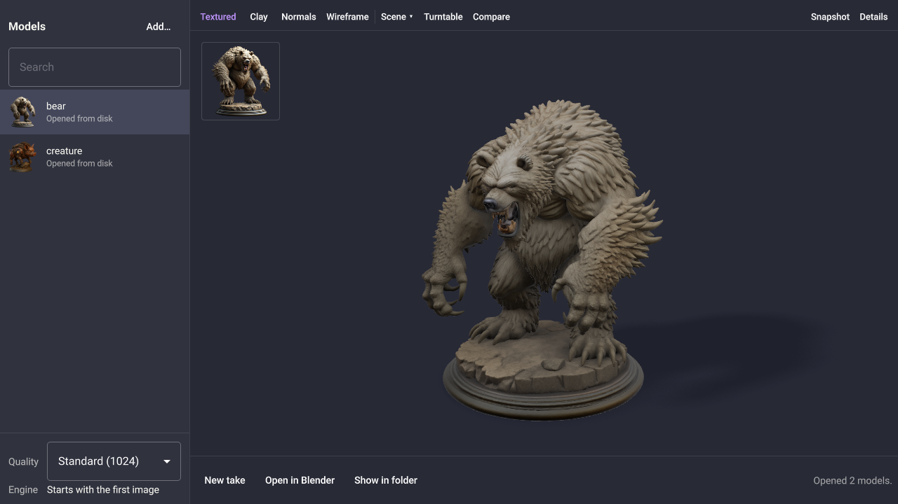

# Omamesh

Turn photos into textured 3D models on your own computer. Drop a photo in,
and a few seconds to a few minutes later it is a model you can turn around,
check, resize and export for Blender, a game engine or a 3D printer. Nothing
is uploaded anywhere: the model, Microsoft's
[TRELLIS.2](https://github.com/microsoft/TRELLIS.2), runs on your graphics
card.



> **Non-commercial use.** TRELLIS.2 bakes textures with NVIDIA software whose
> licence allows research and evaluation only. See [Licences](#licences)
> before using Omamesh, or what it makes, to earn money.

## What you need

| | |
|---|---|
| Graphics card | **NVIDIA** with 16 GB of video memory (made on an RTX 5060 Ti 16 GB), or **AMD Radeon RX 7000 / 9000** with 16 GB (see [AMD graphics cards](#amd-graphics-cards)) |
| Driver | NVIDIA 570 or newer; on AMD, the kernel's own amdgpu driver |
| Memory | 24 GB or more (32 GB is comfortable) |
| Disk | about 45 GB free in your home folder |
| System | Omarchy, or another Arch Linux desktop |

Intel graphics aren't supported yet — see
[Other graphics cards](#other-graphics-cards).

## Install

Installing takes two steps: the app, then the 3D engine it runs.

**1. The app.** Download the package from the
[latest release](https://github.com/28allday/omamesh/releases/latest), then
open a terminal with **Super + Enter** and install it:

```sh
sudo pacman -U ~/Downloads/omamesh-0.2.3-1-x86_64.pkg.tar.zst
```

Type your password when asked, and press Enter to confirm.

(The package is unsigned, so pacman won't install it straight from a URL —
download it first and install the local file. `SHA256SUMS` on the release page
lets you check the download.)

The package is built against the Qt in the Arch repositories on the day of the
release, and runs on that Qt or newer. If pacman answers that `qt6-base>=6.x`
is required, your system is older than that: run `sudo pacman -Syu`, reboot,
and install the package again.

**2. The engine.** In the same terminal, as yourself (no `sudo`):

```sh
omamesh-setup
```

It checks your computer, then sets up everything the model needs in
`~/.local/share/omamesh/engine`: its own Python, the GPU toolkit (CUDA for
NVIDIA, ROCm for AMD) and a compiler, the Python packages, TRELLIS.2's GPU
parts (compiled for your card) and the model itself. It takes 30–60 minutes, mostly downloading (~25 GB) and
compiling, and ends by making a test model.

One step needs you. TRELLIS.2 reads photos with Meta's **DINOv3** model, which
is free but gated on Hugging Face, so setup walks you through it: make a free
account, accept the licence on the
[DINOv3 page](https://huggingface.co/facebook/dinov3-vitl16-pretrain-lvd1689m),
create a *Read* token and paste it in. Approval is usually quick; if it is
still pending, stop and run `omamesh-setup` again later.

If anything fails, the screen shows the last lines and
`~/.local/share/omamesh/engine/install.log` has the rest. Running
`omamesh-setup` again carries on where it stopped.

Then open Omamesh from the app launcher: press **Super + Space** and type
**Omamesh**.

### Building it yourself

If you would rather build the app from source:

```sh
sudo pacman -S --needed base-devel git
git clone https://github.com/28allday/omamesh.git ~/omamesh
cd ~/omamesh
./bin/install
omamesh-setup
```

### Updating

Install the newer package from the
[latest release](https://github.com/28allday/omamesh/releases/latest) the same
way, then run `omamesh-setup` once more. It only redoes what changed, so it is
usually quick. If you built it yourself: `git pull`, `./bin/install`,
`omamesh-setup`.

Close and reopen Omamesh after updating. `omamesh --version` says which
version you have.

### Uninstalling

```sh
sudo pacman -R omamesh
rm -rf ~/.local/share/omamesh
```

The first removes the app; the second the engine (about 35 GB) and the list of
models. Your models stay where they were made, beside their photos. The
Hugging Face token is in `~/.cache/huggingface/token`; delete it too if you
like.

## Making a model

- **Drop** photos (jpg, png, webp, bmp, tif) anywhere in the window, or press
  `Ctrl+O`. Each becomes a `.glb` file next to the photo, shown in the viewer as
  soon as it is done. Dropping a `.glb` opens an existing model; its photo is
  found if it sits beside it.
- **Quality**: Draft is quick, Standard is the default, High is the finest and
  needs the most video memory. It applies to photos added after the change.

  | Quality | RTX 5060 Ti 16 GB | Radeon RX 9060 XT 16 GB |
  |---|---|---|
  | Draft | ~35 seconds | ~1.5 minutes |
  | Standard | ~3 minutes | ~3 minutes |
  | High | ~1.5–4 minutes | not available (needs a 20 GB Radeon) |

  Times are per photo. The engine starts with the first photo and keeps the
  model loaded, so later photos go straight to work.
- **New take** runs the same photo again differently; it is saved as
  `photo-seed<N>.glb`, so earlier takes are kept.
- **Photos of one object on a plain background work best.** The background is
  removed for you, and stray specks around the object are dropped so they
  don't turn into floating bits. Anything the photo doesn't show — the back,
  the underneath — is the model's best guess.

### The list

The list of models is kept between runs, newest first, with a search box.
Anything still being made when you quit comes back stopped, ready to try
again. **Rename** renames the `.glb` file itself; **Move to Bin** sends it to
the desktop's bin; **Remove from list** leaves the file alone.

### Looking at a model

The bar above the model switches between **Textured**, **Clay** (plain grey, to
judge the shape) and **Normals**, with **Wireframe** on top of any of them.
**Scene** holds the lighting (Studio, Soft, Dramatic, or Even with no key
light), exposure, background and the floor shadow. **Turntable** spins the
model; **Compare** puts the photo beside it; **Snapshot** saves what you see as
a PNG next to the model. These settings are remembered.

### Details, orientation, size and export

**Details** shows the faces, vertices, texture sizes and file size. Models
sometimes come out lying down: **Which way is up** turns them a quarter at a
time, and exports keep the turn. **Real size** sets the height in millimetres
and shows the width and depth that follow.

**Export** writes GLB, OBJ (with its textures beside it) or STL. A lighter copy
keeps half, a fifth or a twentieth of the faces and can shrink the textures.
STL comes out in millimetres, Z up and standing on the build plate — at the set
height, or 100 mm tall if none is set. Exporting and **Open in Blender** need
[Blender](https://www.blender.org) installed (`sudo pacman -S blender`).

## Keyboard

| Key | Does |
|---|---|
| `Ctrl+O` | Add photos or models |
| `Ctrl+F` | Search the list |
| `↑` `↓` | Select |
| `N` | New take |
| `Ctrl+R` | Try again |
| `Esc` | Cancel |
| `F2` | Rename the model file |
| `Delete` | Remove from the list |
| `Shift+Delete` | Move the model to the bin |
| `Ctrl+B` | Open in Blender |
| `Ctrl+E` | Show in folder |
| Drag / scroll | Turn / zoom the model |
| `R` | Reset the view |
| `1` `2` `3` | Textured, clay, normals |
| `W` | Wireframe |
| `T` | Turntable |
| `F` | Floor and shadow |
| `C` | Compare with the photo |
| `I` | Details |
| `P` | Snapshot |
| `?` | Keyboard shortcuts |
| `Ctrl+Q` | Quit |

## Command line

The engine also works on its own, with no window:

```sh
img2mesh photo.jpg                 # writes photo.glb next to the photo
img2mesh -q draft *.jpg            # a quick look at several photos
img2mesh -q high -s 7 photo.png    # best quality, a different take
```

(On a Radeon with less than 20 GB, use `-q standard` for the best quality.)

Other options: `--seed` for a different take, `--faces` and `--texture` for
the size of the output, `--video` for a turntable clip, `--keep-background` for
images that are already cut out. `img2mesh --help` lists them all.

## AMD graphics cards

Setup notices a Radeon and installs AMD's version of everything instead:
PyTorch for ROCm and its compiler from AMD's own package index (nothing to
install system-wide first, and no sudo), and community ports of TRELLIS.2's
GPU parts to AMD's HIP, by [Cardboard-box-a](https://github.com/Cardboard-box-a/TRELLIS.2_rocm).
On a machine with both makes of card, the NVIDIA one is used.

- **Tested on** a Radeon RX 9060 XT 16 GB (gfx1200): Draft takes about a
  minute and a half, Standard about three. The RX 9070 series (gfx1201) and
  RX 7000 series (gfx1100–gfx1102) use the same parts but haven't been tried.
- **High quality needs 20 GB or more** of video memory on a Radeon. On a 16 GB
  card, High's last step runs out of memory, so the engine turns High jobs
  down with a note to use Standard.
- **Memory:** Draft and Standard ran on the test machine with 13 GB of RAM,
  with about 2 GB to spare during Standard. Close other large programs while a
  model is being made.
- **Your user needs access to `/dev/kfd`**, which most distributions give
  everyone. If setup says otherwise, add yourself to the `render` group and log
  in again.
- **Changing cards:** if you move the engine to a computer with the other make
  of card, run `omamesh-setup` again. It sets the toolchain up afresh for the
  new card and keeps the downloaded models.
- **Textures, mesh tools and sparse convolutions** come from
  Cardboard-box-a's ports, pinned to tested versions like the NVIDIA ones;
  TRELLIS.2's own O-Voxel builds for AMD as it is.

## Other graphics cards

TRELLIS.2's GPU parts (its rasteriser, mesh tools and sparse convolutions) are
written for NVIDIA's CUDA and ported to AMD's HIP, so setup stops with an
explanation on other cards.

- **Intel (Arc):** nobody has ported TRELLIS.2's GPU parts to Intel graphics
  yet.

## What Omamesh writes

| Where | What |
|---|---|
| Beside each photo | The models (`.glb`), takes, snapshots and exports |
| `~/.local/share/omamesh/library.json` | The list of models |
| `~/.config/omamesh/` | Window and viewer settings |
| `~/.local/share/omamesh/engine/` | The engine: its Python, toolchain, model weights and setup log |
| `~/.cache/huggingface/token` | Your Hugging Face token, saved during setup |

Nothing outside your home folder is touched, and no password is needed for
anything but installing the app itself.

## Licences

Omamesh is MIT licensed. It depends on a lot of other people's work, none of
it bundled: `omamesh-setup` downloads it from the original sources.
[THIRD-PARTY.md](THIRD-PARTY.md) lists every component and its licence. In
short:

- TRELLIS.2 and its model weights, BiRefNet (background removal), CuMesh and
  FlexGEMM are MIT.
- Meta's DINOv3 comes under the DINOv3 Licence, which you accept on Hugging
  Face during setup.
- **NVIDIA's nvdiffrast and nvdiffrec, and the NVIDIA code in CuMesh's cubvh,
  are not free for commercial use**: their
  licences allow use *"for research or evaluation purposes only and not for any
  direct or indirect monetary gain"*. TRELLIS.2 uses them to bake textures, so
  as set up here Omamesh is for **non-commercial use**.
- On AMD, the ports of these keep NVIDIA's licences, so the same applies
  there.
- The CUDA toolkit and NVIDIA's runtime libraries come under NVIDIA's own
  licences (on AMD, the ROCm libraries are open source: MIT,
  Apache-2.0 and NCSA); the app uses Qt 6 (LGPL-3.0, and GPL-3.0 for Qt Quick 3D).
